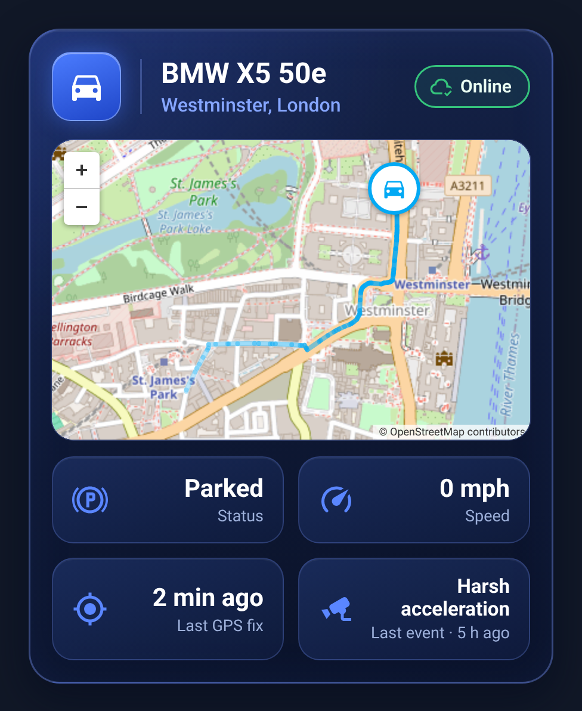
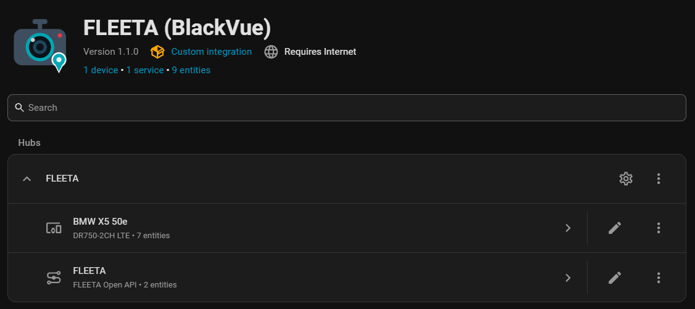
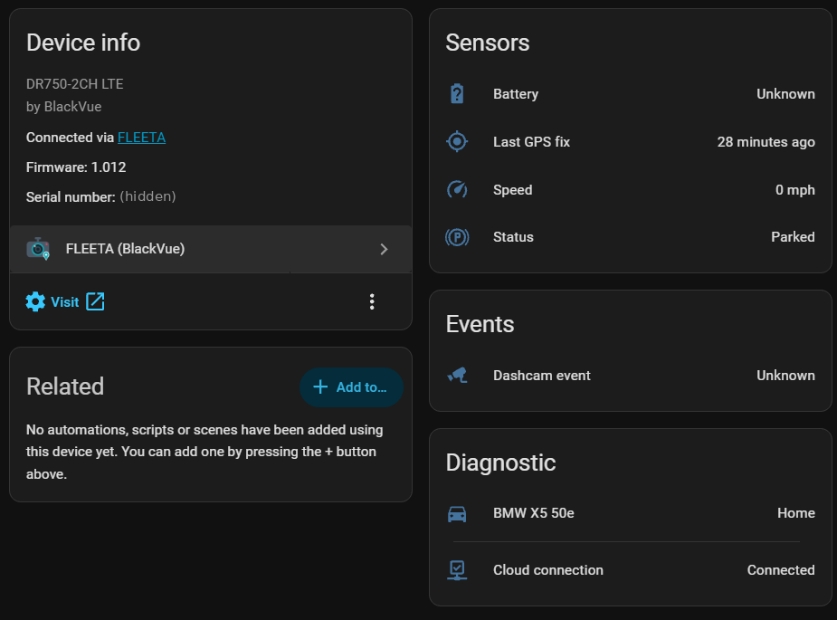
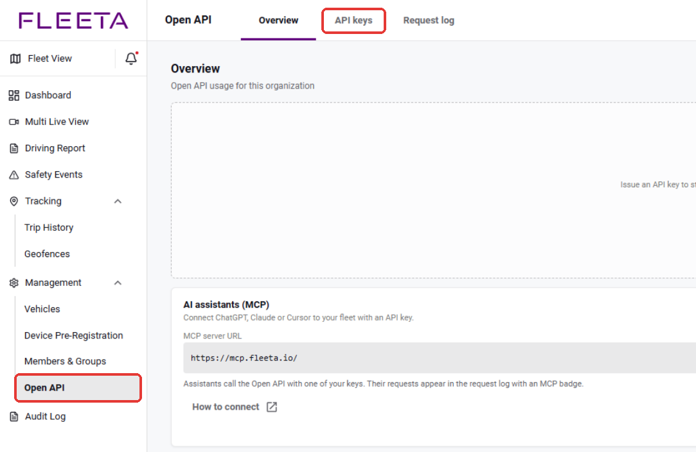
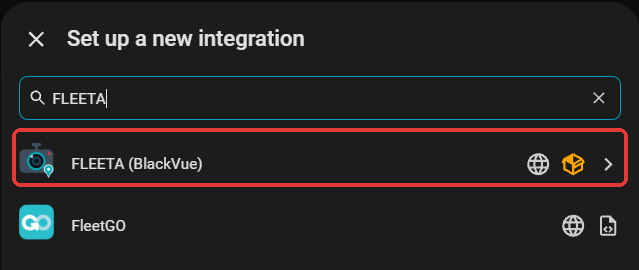
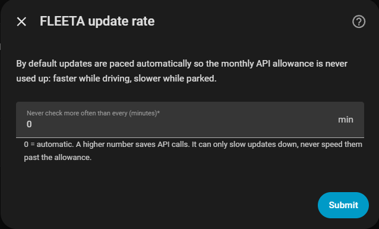

# FLEETA (BlackVue) for Home Assistant

Brings your BlackVue cloud dashcam into Home Assistant using the official
[FLEETA Open API](https://developers.fleeta.io/). See where the car is on your
map, whether it is home or away, its speed, and get an alert in Home Assistant
when the camera records a parking bump or a harsh brake. It comes with its own
**FLEETA Car** dashboard card: a map with the car's route, its status, speed,
last GPS fix and last camera event.

[](https://my.home-assistant.io/redirect/hacs_repository/?owner=0xwilko&repository=ha-fleeta&category=integration)
[](https://my.home-assistant.io/redirect/config_flow_start/?domain=fleeta)



*The FLEETA Car card, shown with example data. In Home Assistant the map is your own Home Assistant map.*



## What you get

For each dashcam on your FLEETA account:

| Entity | What it shows |
|---|---|
| Device tracker | Where the vehicle is on the map, and Home / Away from your zones |
| Speed | Last reported speed (mph by default) |
| Status | Driving, Parked or Offline |
| Last GPS fix | When the position was last updated |
| Dashcam event | Fires on parking impacts, driving impacts, harsh braking and other camera events |
| Cloud connection | Whether the camera is connected to the FLEETA cloud |
| Battery | Battery pack level (only if a BlackVue battery pack is fitted) |

A **FLEETA** account device also shows **API calls this month** and the current **Update interval**.



## Before you start

You need:

- A BlackVue dashcam connected to the FLEETA cloud, on a FLEETA subscription that includes Open API access.
- Home Assistant 2025.6 or newer. On 2026.11 and newer the Marketplace (which used to be HACS) is built in.

## Step 1: Get your FLEETA API key

1. Sign in to the FLEETA web viewer at [app.fleeta.io](https://app.fleeta.io/).
2. Click **Management**, then **Open API**.
3. Click the **API keys** tab and issue a new key.
4. Copy the key. It starts with `flt_live_`.



Keep the key private, like a password. You only paste it into Home Assistant.

## Step 2: Install the integration

Quickest: tap the **Open this repository in HACS** button above, click **Download**,
then restart Home Assistant (**Settings** › **⋮** › **Restart Home Assistant**).

Or by hand:

1. In Home Assistant go to **Settings** › **Marketplace** (on older versions: **HACS**).
2. Click the three dots **⋮** in the top right, then **Custom repositories**.
3. In **Repository** paste `https://github.com/0xwilko/ha-fleeta`.
4. Set **Type** to **Integration** and click **Add**.
5. Close the box, search for **FLEETA** and open **FLEETA (BlackVue)**.
6. Click **Download**, then **Download** again.
7. Restart Home Assistant: **Settings** › **⋮** › **Restart Home Assistant**.

## Step 3: Add your dashcam

Quickest: tap the **Add the FLEETA integration** button above and paste your API key.

Or by hand:

1. Go to **Settings** › **Devices & services**.
2. Click **Add integration** and search for **FLEETA**.
3. Click **FLEETA (BlackVue)**.
4. Paste your API key and click **Submit**.
5. Pick an area if you want one, then click **Finish**.



Your dashcam appears as a device named the same as in the FLEETA app.

## Step 4: Use it

### The FLEETA Car card

The card comes with the integration. There is nothing else to download and no
dashboard resource to add.

1. Open a dashboard, click the pencil (**Edit dashboard**), then **Add card**.
2. Search for **FLEETA Car** and pick it. It finds your car by itself.
3. Click **Save**.

It shows the car's name and where it is, an Online or Offline badge, a live map
with the car's route, and four tiles: **Status**, **Speed**, **Last GPS fix** and
**Last event**. Tap any tile for its history.

| Option | Default | What it does |
|---|---|---|
| Car | first FLEETA car | Which dashcam to show |
| Name | the car's name | A different name for the card |
| Place shown under the name | Zone | **Zone** shows Home, Work or Away from your zones. **Street and town** shows, for example, "Westminster, London" (see Privacy) |
| Route trail | 24 hours | Hours of route drawn on the map. 0 for none |
| Map style | Light | Light, Dark, or follow your theme |
| Show the map | on | Turn off for a smaller card with just the tiles |

In YAML the card is simply:

```yaml
type: custom:fleeta-card
```

You can also use Home Assistant's own **Map** card with the dashcam's device
tracker (for example `device_tracker.my_car`).

### Get a phone alert on a parking impact

**Settings** › **Automations & scenes** › **Create automation** › **Create new automation** ›
**⋮** › **Edit in YAML**, paste this, then change the two names marked below:

```yaml
alias: Dashcam parking impact alert
triggers:
  - trigger: state
    entity_id: event.my_car_dashcam_event  # change to your dashcam event entity
    not_to:
      - unavailable
      - unknown
conditions:
  - condition: state
    entity_id: event.my_car_dashcam_event  # same entity again
    attribute: event_type
    state: parking_impact
actions:
  - action: notify.mobile_app_my_phone  # change to your phone
    data:
      title: Dashcam
      message: The dashcam recorded a parking impact.
mode: single
```

Other event types you can use instead of `parking_impact` include
`driving_impact`, `harsh_braking`, `harsh_acceleration`, `sharp_turn` and `overspeed`.

## How often it updates

FLEETA gives each account a monthly allowance of API calls. The integration
reads your allowance from FLEETA and paces itself so it never runs out before
the month ends. It checks more often while the car is moving and less often
while it is parked. On a Pro allowance with one camera that is roughly every
5 minutes while driving and every 15 minutes while parked.

To slow it down further (for example if you also use FLEETA's AI assistant
connection), open the integration and click the cog:



The setting can only slow updates down. It can never make them use more than
your allowance.

## Privacy and security

- Your API key is stored only in Home Assistant. It is never written to the log.
- Read-only: the integration never changes camera settings and never requests
  video, so it does not use your video allowance or the camera's mobile data.
- It only ever talks to `openapi.fleeta.io` and refuses redirects, so the key
  cannot be sent anywhere else.
- Everything that comes back from FLEETA is checked before Home Assistant sees
  it. Text is cleaned and shortened, and numbers must be in a sensible range.
- The FLEETA Car card only talks to your own Home Assistant. The one exception is
  the optional **Street and town** place setting: then the card sends the car's
  position to OpenStreetMap (`nominatim.openstreetmap.org`) to look up the street
  and town, at most once a minute, and remembers the answers on that device. In a
  zone such as Home it shows the zone name and looks nothing up. It is off by default.
- **Download diagnostics** removes the key, camera serial numbers, camera names
  and GPS positions, so it is safe to share when asking for help.

## Troubleshooting

| You see | What to do |
|---|---|
| "That doesn't look like a FLEETA API key" | Copy the whole key; it starts with `flt_` |
| "FLEETA rejected the API key" | The key was mistyped or revoked. Issue a new one in FLEETA |
| "This FLEETA plan doesn't include GPS access" | Your FLEETA plan has no Open API GPS access. Check your plan with FLEETA |
| "monthly API allowance is used up" | Updates resume on the 1st. Raise the update interval option to use fewer calls |
| Last GPS fix is hours old | Normal while the car is parked; FLEETA only sends a new position when it moves |
| Battery shows Unknown | FLEETA reports a battery pack but no level. It fills in if FLEETA sends one |

To report a problem, open an [issue](https://github.com/0xwilko/ha-fleeta/issues)
and attach **Download diagnostics** from the integration's **⋮** menu.

## Removing it

**Settings** › **Devices & services** › **FLEETA (BlackVue)** › **⋮** › **Delete**.
Then revoke the API key in FLEETA under **Management** › **Open API** › **API keys**.

---

This is an unofficial community integration. It is not made or endorsed by
BlackVue or FLEETA (Pittasoft Co., Ltd.). BlackVue and FLEETA are trademarks
of their owners.
